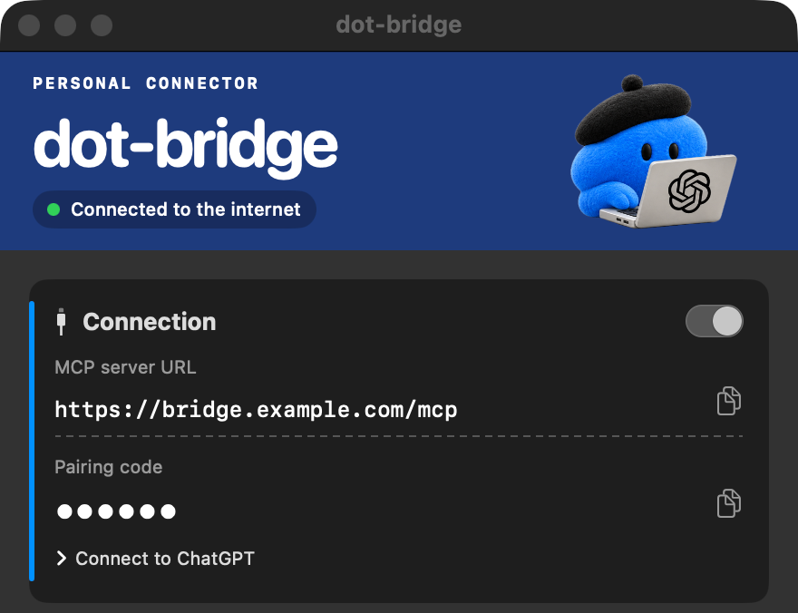

# dot-bridge

Ask your ChatGPT dot from your phone to check a file or start a Codex task on your Mac. **dot-bridge** exposes local tools through a custom Model Context Protocol (MCP) plugin, without requiring the ChatGPT desktop app. Your Mac runs the tools; the plugin appears under **Plugins** in ChatGPT.



## What you can do

- **Inspect a project:** list a directory or read a text file without sending the entire repository to a cloud computer.
- **Work on the Mac:** edit a file, run a shell command, or start a local Codex task and check its output. Available actions depend on your ChatGPT plan and workspace permissions.
- **Control access locally:** approve each pairing on the Mac, watch activity, and revoke individual connections from the app.

## Requirements

- macOS 15+ for the menu bar app
- Node 20+
- `cloudflared` (`brew install cloudflared`)
- `codex` CLI, only for the Codex tools
- A ChatGPT plan that can add custom MCP servers. OpenAI's docs say Pro gets read/fetch tools only and Business/Enterprise get write tools. Plus isn't documented.

## Install

Homebrew installs the native app, Node, and `cloudflared`:

```sh
brew install --cask apoorvdarshan/tap/dot-bridge
open -a dot-bridge
```

Or install from npm on macOS with Node 20+:

```sh
npm install -g dot-bridge
dot-bridge-install-app
open -a dot-bridge
```

For terminal-only use, skip the last two commands and run `dot-bridge`.
You can also download the `.tgz` from [GitHub Releases](https://github.com/apoorvdarshan/dot-bridge/releases)
and install it locally with `npm install -g ./dot-bridge-0.1.0.tgz`.
Install `cloudflared` separately for temporary URLs. The npm installer also
accepts a destination directory and does not overwrite an existing app.
Each Mac creates its own temporary address unless you configure a permanent one.

## Build the Mac app

`app/` is a small native SwiftUI app (no Electron). It shows in the Dock and the menu bar by default (either can be hidden), and controls the bridge:

- Start/stop switch, status light, and live activity list
- MCP URL and pairing code with copy buttons
- A separate window you can open or hide
- Settings: show in Dock (on by default), open at login, start on launch, allowed folders, fixed public URL, Node path, port

From the repository root, with Xcode and its Swift toolchain installed:

```sh
npm install
app/build.sh
open build/dot-bridge.app
```

The app bundles `server.mjs` and its dependencies, and uses the `node` and `cloudflared` installed on your Mac. It is ad-hoc signed, so the first launch may need right-click → Open.

## Run without the app

```sh
npm install
npm start
```

## Connect ChatGPT

Keep the bridge running. Copy the MCP URL and six-digit code from the app’s **Connection** section or the interactive CLI terminal.

1. In ChatGPT on the web, open **Plugins → + → Add custom MCP server**.
2. Paste the URL, choose **OAuth**, accept the warning, and select **Create as a plugin**, then install it.
3. Enter the pairing code in the browser. Match its request ID in dot-bridge on your Mac and click **Approve** within 60 seconds. If running in a terminal instead, enter the displayed `approve` command there.
4. Ask your dot: `Use the dot-bridge plugin's computer_info tool.`

## Keep the same URL

Each Mac chooses its own hosting mode under **Settings → Hosting → Address**. Temporary URL is the default. To keep the same address across restarts:

1. In **your own** Cloudflare account, create a [named tunnel](https://developers.cloudflare.com/cloudflare-one/networks/connectors/cloudflare-tunnel/get-started/create-remote-tunnel/). Follow Cloudflare's connector installation steps on the Mac running dot-bridge.
2. Add a published application route for a hostname on your domain, e.g. `bridge.example.com`, with service `http://127.0.0.1:8787` (or the local port in Settings). An existing HTTPS reverse proxy can serve the same purpose.
3. Select **My permanent URL**, enter `https://bridge.example.com`, then stop and start the bridge. The app checks that the hostname reaches this specific Mac before showing it as connected.
4. Connect the new `https://bridge.example.com/mcp` address in ChatGPT once. The Mac and its connector must be running for it to work. Switching back to **Temporary URL** preserves the saved hostname.

For the CLI, set `PUBLIC_URL=https://your-host` and optionally `DOT_BRIDGE_CHECK_ROUTE=1` to verify the route on startup.

## Tools

| Tool | Read-only |
| --- | --- |
| `computer_info` | yes |
| `list_files` | yes |
| `read_file` | yes |
| `codex_task_status` | yes |
| `write_file` | no |
| `run_command` | no |
| `start_codex_task` | no |

## Settings

| Variable | Default |
| --- | --- |
| `PORT` | `8787` |
| `PUBLIC_URL` | starts a Cloudflare quick tunnel |
| `DOT_BRIDGE_ROOTS` | your home folder (`:`-separated list) |
| `DOT_BRIDGE_DIR` | `~/.dot-bridge` (tokens and activity log) |

## Security

A pairing code alone does not grant access. The Mac owner must approve the matching browser request locally. Approval authorizes that OAuth connection, not a verified individual ChatGPT identity. Earlier code-only sessions must pair again after upgrading. To invalidate a connection’s access and refresh tokens, open **Paired connections → Revoke**, or use the displayed `revoke` command in the local CLI. Revocation blocks future requests; it does not undo actions or stop already-running jobs.

Approved clients can run commands with your macOS user's permissions. The allowed folders constrain file tools and working-directory selection; they are not a shell sandbox. Keep the pairing code and `~/.dot-bridge/state.json` private. Five wrong codes lock pairing until restart.
